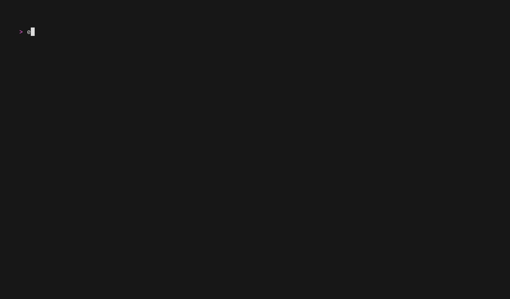

<!-- Please do not edit this file directly. Update README.mld instead. -->

# ochre

A syntax highlighter for OCaml using TextMate grammars and themes, inspired by [Shiki](https://shiki.style/).



## Installation

```bash
opam install ochre -y
```

## Quick start

```ocaml
let ( let* ) = Result.bind in
let* highlighter = Ochre.load_from_files ["path/to/ocaml.tmLanguage.json"] in
let* lang = Ochre.lang highlighter "ocaml" in
let source_code = "..." in
Ok (Ochre.to_html (Ochre.highlight ~theme:Ochre.Theme.nord ~lang source_code))
```
Loading and language lookup return `(_, Ochre.Error.t) result`; rendering never fails.


## Load any TextMate grammar with tm-grammars

[tm-grammars](https://github.com/davesnx/tm-grammars) packages a collection of TextMate grammars for OCaml, so you can load grammars in `ochre` without managing JSON files on disk.

Install the bundled grammar package:

```
opam install tm-grammars -y
```
Then load a grammar from OCaml and create a highlighter. The `ocaml` grammar includes rules from `ocaml-interface`, so load both:

```ocaml
let ( let* ) = Result.bind in
let* highlighter =
  Ochre.load
    [ ("ocaml", Tm_grammars.ocaml); ("ocaml-interface", Tm_grammars.ocaml_interface) ]
in
let* lang = Ochre.lang highlighter "ocaml" in
Ok (Ochre.to_html (Ochre.highlight ~theme:Ochre.Theme.nord ~lang "let x = 42"))
```
Try every built-in theme with several grammars in the [playground](https://davesnx.github.io/ochre/playground.html).


## Output formats

`ochre` can render highlighted code to several output formats (also called backends):

- **HTML** — Self-contained `<pre><code>` blocks with inline styles or CSS classes. Supports multi-theme via CSS custom properties, line numbers, and configurable class prefixes. See [rendered example](https://davesnx.github.io/ochre/examples/html-preview.html).
- **SVG** — Standalone `<svg>` elements with monospace `<text>` and per-token `<tspan>` styling. Open preview: [SVG rendered example](https://davesnx.github.io/ochre/examples/svg-preview.svg). Source: [.svg file](test/svg-preview.svg).
- **ANSI** — 24-bit color escape sequences for terminal display.
- **LaTeX** — `\textcolor` commands inside an `ochrehighlight` environment. Requires the `xcolor` and `ulem` packages. See [rendered PDF](https://davesnx.github.io/ochre/examples/latex-preview.pdf) (source: [.tex file](test/latex-preview.tex)).
All backends share the same interface: load a highlighter, look up a language, highlight the code with one or more themes, and call the corresponding `to_*` function.


## Documentation

- [Library API](docs/README.md)
- [Command-line reference](docs/cli.md)

## Contribute

Set up the development environment:

```
make init
```
Build the project:

```
make build
```
Run the test suite:

```
make test
```
You can also preview highlighted output in a browser with `make test-browser`, which serves a sample on port 5000\.


## Credits

- Inspired by [Shiki](https://shiki.style/) by [Pine Wu](https://github.com/octref) and [Anthony Fu](https://github.com/antfu)
- Uses [textmate-language](https://github.com/alan-j-hu/ocaml-textmate-language) and [ocaml-oniguruma](https://github.com/alan-j-hu/ocaml-oniguruma) by [Alan Hu](https://github.com/alan-j-hu)